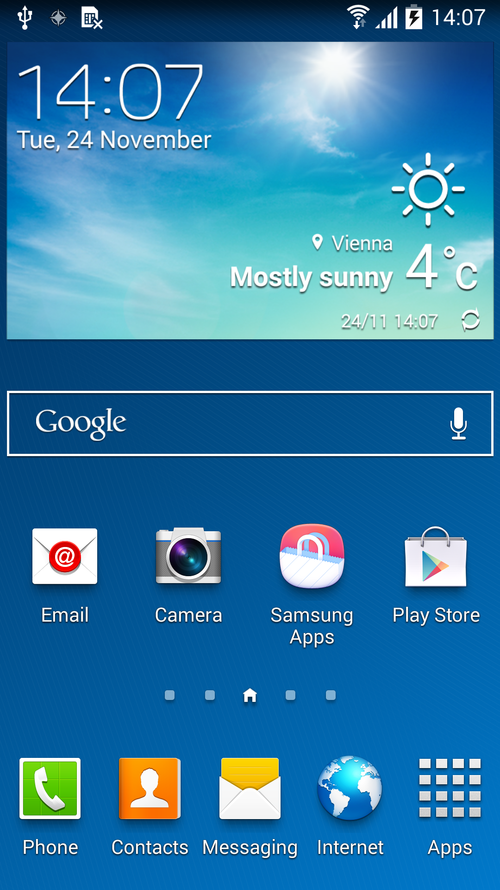
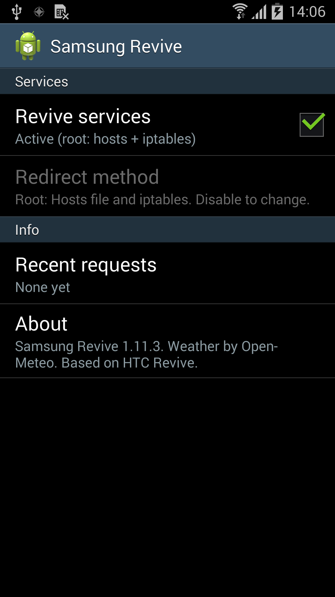

# Samsung Revive

Brings the dead online widgets of **Samsung TouchWiz phones (Galaxy S to Galaxy S4)** back to
life, entirely on the phone. No PC, proxy server or API key needed.

> **Prototype.** Tested on a Galaxy S (GT-I9000, Android 2.2.1), Galaxy S2 (Android 2.3),
> Galaxy S3 (GT-I9300, Android 4.1) and Galaxy S4 (GT-I9505, Android 4.4.2). Other TouchWiz
> phones of that era ship the same apps and probably work. Reports welcome.

<p>




</p>

| Feature | Original backend (dead) | Samsung Revive serves it from |
|---|---|---|
| AccuWeather widget, weather app, map, Daily Briefing weather | `samsungmobile.accu-weather.com` | [Open-Meteo](https://open-meteo.com/) |
| AP News widget, Daily Briefing news | `samsungrss.vrvm.com`, `mnndev.vrvm.com` | RSS/Atom feeds you choose |
| Yahoo! News widget | `samsung-mobile.query.yahooapis.com` (YQL) | the same RSS/Atom feeds |
| Yahoo! Finance / stock clock widget, Daily Briefing stocks | `samsung-mobile.query.yahooapis.com`, `samsung-finance.api.mobile.yahoo.com` | Yahoo Finance public endpoints |

The stock Samsung apps stay untouched. Samsung Revive runs small local servers that speak each
app's original protocol, and redirects the dead hostnames to them.

## What works where

| Phone | Weather | AP News | Yahoo! News | Yahoo! Finance | Other |
|---|---|---|---|---|---|
| Galaxy S (2.2) | Daily Briefing | Daily Briefing | | stock clock, Daily Briefing | |
| Galaxy S2 (2.3) | widget, app | widget, app | | | |
| Galaxy S3 (4.1) | widget, app | | widget, app | widget, app | |
| Galaxy S4 (4.4) | widget, app, map | | widget, app | widget, app | Briefing widget |

Blank cells mean the phone doesn't have that app, or it hasn't been tried there.

## Redirect modes

| Mode | Needs | How it works |
|---|---|---|
| **Root** (recommended) | `su` | Adds the dead hosts to `/system/etc/hosts` and redirects ports 80/443 to the local servers with iptables. Installs the local CA into the system trust store on Android 4.x. |
| **VPN** | Android 4.0+ | A local VpnService answers DNS for the dead hosts and bridges their traffic to the local servers. Nothing else is routed through it. |
| **Wi-Fi proxy** | Android 4.0+ | Set the Wi-Fi proxy to `127.0.0.1:28081`. |

Android 2.x supports root mode only. In VPN and proxy modes, the 2013 AccuWeather app (Galaxy S4)
checks HTTPS certificates, so the app offers to install its local CA. Root mode installs it for you.

## Install and use

1. Build the APK (below) and `adb install SamsungRevive.apk`.
2. Open **Samsung Revive**, pick a redirect method, tick **Revive services** and grant root if
   asked.
3. Refresh the widgets. **Recent requests** shows what each app asked for.

News categories (for AP News and Yahoo! News) are set under **Categories**, one
`Name|https://feed.url` per line.

## Notes

- **Clock fallback**: if the phone's clock has reset (common on old batteries), Samsung Revive
  sets it from an HTTP `Date` header in root mode. Without that, TLS refuses every certificate.
- **Article links** from Yahoo! News open a plain-HTTP reader page served by the app, because
  the stock browser can't reach modern HTTPS news sites.
- **Galaxy S (2.2)**: the service doesn't restart itself after an app update (Android 2.2 has no
  package-replaced broadcast); open the app once.
- **Not covered**: Flipboard (needs TLS 1.2 and forces an update), the S4 Travel widget
  (TripAdvisor), Briefing's ESPN sports and Facebook cards.

## Building

Needs Python 3 with `cryptography`, a JDK, and a `TOOLS` directory containing `android-17.jar`
(or `android-19.jar`), `aapt2`, `r8.jar` and `apksig.jar`:

```sh
TOOLS=/path/to/tools ./build.sh
```

The first build runs `tools/gen-certs.py`, which creates a local CA and a `*.accu-weather.com`
leaf in `assets/`, and creates a signing key in `certs/`. Both are per-build secrets and are
ignored by git. A new CA has to be installed on the phones again.

## Licence

GPL-3.0-or-later, because the bundled TLS bridge links wolfSSL. See [LICENSE](LICENSE) and
[CREDITS.md](CREDITS.md).
